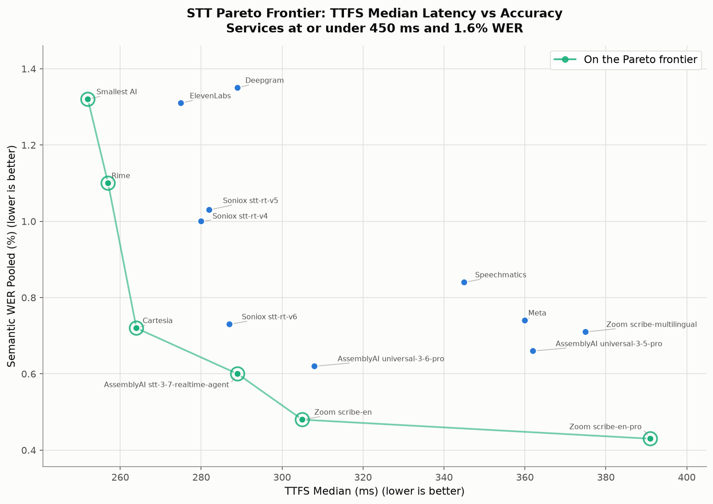

# STT Benchmark

A benchmark of streaming Speech-to-Text services for real-time voice agents. It measures how accurate each service's transcripts are (Semantic WER) and how soon after the user stops speaking the complete transcript arrives (TTFS, Time To Final Segment).

## What This Benchmark Measures

In a voice agent, the STT service sits between the user's audio and the LLM. The agent can't start its reply until it has the complete transcript of what the user just said, so two things decide whether an STT service works well there:

- **Accuracy.** Are the words right in the ways that change what the LLM understands? This is [Semantic WER](#semantic-wer).
- **Latency to the complete transcript.** How long after the user stops speaking does the last piece of the transcript arrive? This is [TTFS](#ttfs-measurement).

Every service is measured in the same position it holds in an agent: inside a [Pipecat](https://github.com/pipecat-ai/pipecat) pipeline, receiving audio in real time over a live connection, with a local VAD deciding when the user has stopped speaking. Each sample is one user turn.

**Reading TTFS.** TTFS is when the complete transcript arrived. An agent can act at that moment only if it knows the transcript is complete, and that depends on the service:

- A service that **signals completion** (it marks the last transcript for a turn as final) lets the agent move on as soon as that transcript arrives. The agent's wait is the TTFS of that turn, so the median is what users typically experience.
- A service that **gives no signal** leaves the agent guessing whether more text is coming. The agent has to wait a fixed time long enough to cover nearly every turn, in practice the service's TTFS P99, on every turn. For these services the P99 column is the latency users experience, not the median.

Two services with the same median can therefore feel very different in an agent: one responds at its median, the other at its P99. The benchmark itself records TTFS the same way for both, after the fact; see [TTFS Measurement](#ttfs-measurement).

**What it doesn't measure.** The service's own turn detection is left out; the pipeline's VAD ends each turn for every service. Samples are single English utterances, so the results say nothing about other languages, long-form audio, or multi-speaker audio. Latency is measured from one network location and includes the network path to each service, so the same service measures differently from somewhere else; see [Running From the Cloud](docs/cloud.md) for a fixed one.

## Results Summary

Benchmark results on 1000 samples from the `pipecat-ai/smart-turn-data-v3.1-train` dataset. Every row was measured between 23 and 26 November 2026 from one AWS instance in `us-west-2`, on the same benchmark code and Pipecat version, and scored by the same judge. Earlier results are under [History](#history).

<!-- RESULTS_TABLE:START -->
| Vendor | Model | Transcripts | Perfect | WER Mean | Pooled WER | TTFS Median | TTFS P95 | TTFS P99 |
|--------|-------|-------------|---------|----------|------------|-------------|----------|----------|
| AssemblyAI | assemblyai-stt-3-7-realtime-agent | 100.0% | 91.9% | 0.63% | 0.60% | 289ms | 412ms | 514ms |
| AssemblyAI | universal-3-5-pro | 100.0% | 89.5% | 0.79% | 0.66% | 362ms | 547ms | 661ms |
| AssemblyAI | universal-3-6-pro | 100.0% | 90.5% | 0.74% | 0.62% | 308ms | 399ms | 440ms |
| AWS | N/A | 100.0% | 79.9% | 1.26% | 1.32% | 736ms | 1062ms | 1392ms |
| Azure | N/A | 100.0% | 83.0% | 1.05% | 1.03% | 945ms | 1134ms | 1650ms |
| Cartesia | ink-2 | 99.9% | 88.1% | 0.74% | 0.72% | 264ms | 285ms | 298ms |
| Deepgram | nova-3-general | 100.0% | 79.2% | 1.35% | 1.35% | 289ms | 371ms | 420ms |
| ElevenLabs | scribe_v2_realtime | 99.9% | 86.2% | 1.20% | 1.31% | 275ms | 292ms | 307ms |
| Google | gemini-3.5-transcribe-live | 99.9% | 84.6% | 1.26% | 1.28% | 461ms | 533ms | 593ms |
| Google | latest-long | 100.0% | 69.0% | 2.54% | 2.52% | 798ms | 946ms | 1246ms |
| Gradium | default | 99.8% | 71.7% | 2.15% | 2.06% | 520ms | 532ms | 535ms |
| Meta | muse-voice-transcribe-1.0 | 100.0% | 88.8% | 0.91% | 0.74% | 360ms | 1106ms | 1825ms |
| Mistral | voxtral-mini-transcribe-realtime-2602 | 99.9% | 76.1% | 2.65% | 2.97% | 616ms | 783ms | 938ms |
| OpenAI | gpt-4o-transcribe | 99.9% | 82.4% | 2.11% | 2.05% | 782ms | 1058ms | 1298ms |
| OpenAI | gpt-realtime-whisper | 100.0% | 81.5% | 1.42% | 1.51% | 759ms | 934ms | 1097ms |
| Rime | N/A | 99.9% | 85.1% | 1.09% | 1.10% | 257ms | 294ms | 333ms |
| Smallest AI | pulse | 100.0% | 79.0% | 1.43% | 1.32% | 252ms | 732ms | 1090ms |
| Soniox | stt-rt-v6 | 100.0% | 87.9% | 0.78% | 0.73% | 287ms | 350ms | 360ms |
| Soniox | stt-rt-v4 | 100.0% | 85.0% | 1.02% | 1.00% | 280ms | 348ms | 360ms |
| Soniox | stt-rt-v5 | 100.0% | 84.5% | 1.03% | 1.03% | 282ms | 346ms | 360ms |
| Speechmatics | linden-1 | 99.9% | 85.4% | 0.99% | 0.84% | 345ms | 386ms | 404ms |
| xAI | grok-voice-transcribe-2.0 | 99.8% | 90.7% | 0.83% | 0.58% | 1126ms | 1608ms | 1948ms |
| Zoom | zoom-scribe-en | 100.0% | 92.2% | 0.56% | 0.48% | 305ms | 392ms | 436ms |
| Zoom | zoom-scribe-en-pro | 99.9% | 93.4% | 0.57% | 0.43% | 391ms | 586ms | 675ms |
| Zoom | zoom-scribe-multilingual | 99.9% | 88.9% | 0.78% | 0.71% | 375ms | 553ms | 637ms |
<!-- RESULTS_TABLE:END -->

Small WER differences aren't meaningful on this data. Among the most accurate services, differences of less than about 0.25 percentage points are within the 95% confidence interval from bootstrap resampling of the benchmark samples, so those services can't be reliably ranked against each other; the margin is wider for less accurate services.

Small latency differences aren't meaningful either. The same service measured in different sessions differed by about 10 ms in its median, so services within about 15 ms of each other can't be reliably ranked.

Azure was measured against its `eastus` region from `us-west-2`, so its latency includes a cross-country round trip that a same-region deployment would not have.

Each service runs with the settings its Pipecat integration uses by default. Several have settings that trade accuracy for latency, which these results don't explore.

### Latency vs Accuracy Trade-off

**Typical Latency (Median)**


Most services sit in the fast, accurate corner, outlined above. The chart below enlarges it:



The Pareto frontier shows services that offer the best trade-off between latency and accuracy—no other service is better on both metrics. Services on the frontier represent efficient choices depending on your priorities. They are drawn in green and joined by a line; a blue point is not on the frontier, however close it sits to one that is. The frontier is worked out over every service, so it is the same in both charts.

Each point is a service's pooled WER. Points close together on either axis may not differ meaningfully; see the notes under the [results table](#results-summary).

### Latency Consistency

**Median / P95 / P99 by Service**


For production voice agents, **tail latency matters more than median**. Even occasional high latency (5% of interactions) can break the conversational flow. A service with a great median but a long tail indicates inconsistent performance—the length of each row above is the size of that service's latency tail.

### Metrics Glossary

| Metric | Description |
|--------|-------------|
| **Transcripts** | Percentage of samples where STT successfully returned a transcription. A sample fails when the service returns nothing or reports an error, such as a lost connection, while it runs. Failed samples are left out of the WER, Perfect and TTFS columns |
| **Perfect** | Transcriptions with 0% semantic WER, out of the samples with a transcription |
| **WER Mean** | Average semantic word error rate across samples |
| **Pooled WER** | Weighted WER (total errors / total reference words) |
| **TTFS Median** | Median time from when the user stops speaking to when the last transcription segment for the turn arrives |
| **TTFS P95** | 95th percentile TTFS - worst 5% of samples have latency above this |
| **TTFS P99** | 99th percentile TTFS - worst 1% of samples have latency above this |

> **Semantic WER** measures only transcription errors that would impact an LLM agent's understanding. Punctuation, contractions, filler words, and equivalent phrasings are ignored.

> **TTFS (Time To Final Segment)** is measured from when the user stops speaking to when the last transcription segment for that turn is received: the moment the transcript is complete. Which percentile matters depends on the service; see [Reading TTFS](#what-this-benchmark-measures).

### History

The table and charts above are the latest results. Each full run is also kept as a dated snapshot under [`results/`](results/), so changes can be tracked over time:

| Snapshot | Measured | From | Services |
|----------|----------|------|----------|
| [2026-11](results/2026-11/) | 23–26 November 2026 | AWS `us-west-2` | 25 |

Each snapshot folder holds `summary.csv` (the table's numbers), `run.json` (region, Pipecat version, benchmark commit, judge and caveats), and the charts. [`results/history.csv`](results/history.csv) holds every snapshot's rows in one file. Compare snapshots with their `run.json` in hand: a change in region, Pipecat version or judge moves the numbers on its own.

Results published before the first snapshot were measured over several months, from more than one location and with two judges, so they are not kept as a snapshot; they remain in the git history. Five rows from that table were not carried over: AssemblyAI universal-streaming-english, Cartesia ink-whisper and the earlier Speechmatics model have been superseded, and the two NVIDIA Nemotron models run locally and were not re-measured.

## Contributing a Result

The Results Summary table above is the **single source of truth** for the
published numbers and the Pareto charts. Multiple people contribute, so results
are added one row at a time rather than by rebuilding the whole table. To add
your model's result:

1. Benchmark and score it locally:
   ```bash
   uv run stt-benchmark run --services <key>
   uv run stt-benchmark wer --services <key>
   ```
2. Upsert just your row into the table — this reads only your service's metrics
   from your local database and leaves every other vendor's row untouched:
   ```bash
   uv run stt-benchmark update-readme --services <key>
   ```
3. Regenerate the charts from the table (read-only with respect to the README),
   then commit `README.md` and `assets/*.png`:
   ```bash
   uv run python scripts/pareto-frontier-plot.py
   ```

A brand-new vendor or model also needs a registry entry first — see
**[Adding Models](docs/adding-models.md)** for the full checklist.

## Measure TTFS for Your Service

If you're using Pipecat and want TTFS latency numbers for your STT service and configuration, see **[Measuring TTFS](docs/measuring-ttfs.md)** for a quick start guide. The P95/P99 values from this tool can be used directly in Pipecat's `ttfs_p99_latency` service configuration (Pipecat 0.0.102+).

## Quick Start

```bash
# Install dependencies
uv sync

# Download audio samples
uv run stt-benchmark download --num-samples 100

# Run benchmarks
uv run stt-benchmark run --services deepgram,openai

# Generate ground truth (Gemini)
uv run stt-benchmark ground-truth

# Calculate semantic WER (Claude)
uv run stt-benchmark wer

# View results
uv run stt-benchmark report
```

## Installation

Requires Python 3.11+ and [uv](https://docs.astral.sh/uv/).

```bash
git clone <repo-url>
cd stt-benchmark
uv sync
```

## Environment Variables

Copy `env.example` to `.env` and set your API keys:

```bash
cp env.example .env
```

## How It Works

### Running a Sample

Each sample is run by [Pipecat's eval harness](https://github.com/pipecat-ai/pipecat/tree/main/evals), the same one that tests Pipecat's own bots. For every sample, `stt-benchmark run`:

1. Starts a small bot ([`evals/bot.py`](src/stt_benchmark/evals/bot.py)) holding a Silero VAD and the STT service under test. A fresh bot per sample means a fresh connection to the STT service per sample.
2. Has the harness connect to it as a client and play the sample in real time, followed by silence, as a caller would. When the sample's audio has finished, the harness tells the bot so with a marker (a DTMF keypress, sent as data, which the STT service never hears).
3. Lets the bot collect every final transcript and the service's TTFS. The bot decides the sample is done once the audio has finished and the STT service has been quiet for 2 seconds (10 seconds at most).
4. Stores the result the bot reports back.

Samples run one at a time unless you ask for more with `--concurrency`; see [Concurrency](docs/cli.md#concurrency).

### TTFS Measurement

**TTFS for STT is different from typical request/response latency.** Since STT services receive continuous audio input, there's no discrete request to measure from. Instead, we measure from when the user **stops speaking** to when the **last transcript for that turn** arrives. That is the moment the agent has everything the user said.

```
┌─────────────────────────────────────────────────────────────────────────────┐
│ VADUserStartedSpeaking              Actual speech    VADUserStopped         │
│        t=0                            ends           SpeakingFrame          │
│         │                              │                  │                 │
│         ▼                              ▼                  ▼                 │
│  ═══════╪══════════════════════════════╪══════════════════╪════             │
│         │      Audio streaming to STT  │   VAD stop_secs  │                 │
│         │                              │◄────────────────►│                 │
│         │                              │                  │                 │
│         │                              └──── TTFS ────────┼────────►        │
│         │                           speech_end_time       │     T3          │
│         │                                                 │  (last          │
│         │     T1              T2                          │ transcript)     │
│         │      │               │                          │                 │
│         │      ▼               ▼                          │                 │
│         │  transcript      transcript                     │                 │
└─────────────────────────────────────────────────────────────────────────────┘
```

**Key points:**
- `speech_end_time` = `VADUserStoppedSpeakingFrame` timestamp − VAD `stop_secs`
- TTFS = last `TranscriptionFrame` receipt time − `speech_end_time`
- Streaming services emit several transcripts for one turn; we use the **last** one

**Why the last transcript?** An agent that replied after an earlier one would be answering part of what the user said, so the turn's latency is set by the last one.

**How the last transcript is identified.** There are two cases, and they give the same measurement:

- **The service signals completion.** When the VAD reports the end of speech, Pipecat asks the service to finish the turn, where the service supports it. The service's reply confirms that the transcript is complete, and Pipecat marks that transcript as finalized. TTFS is reported as soon as it arrives.
- **The service gives no signal.** Pipecat waits 2 seconds after the VAD reports the end of speech and takes the last transcript that arrived in that window. TTFS is the time that transcript arrived, not the end of the wait.

The benchmark can wait and look back; a live agent can't, which is why the signal changes how the results should be read. See [Reading TTFS](#what-this-benchmark-measures).

### Semantic WER

Traditional WER penalizes every word difference equally. "gonna" vs "going to" counts as 2 errors.

**Semantic WER** uses Claude to evaluate whether differences actually matter:

| Ignored (not errors) | Counted (errors) |
|---------------------|------------------|
| Punctuation, capitalization | Word substitutions that change meaning |
| Contractions ("don't" → "do not") | Nonsense/hallucinated words |
| Singular/plural ("license" → "licenses") | Missing words that change intent |
| Filler words ("um", "uh") | Wrong names, numbers, negations |
| Number formats ("3" → "three") | Factual errors |
| Repeated words, stutters, and restarts ("I, I guess") | A word split or merged ("backyard" → "back card"), as one error |

This gives accuracy metrics that reflect real-world impact on downstream LLM applications.

The judge lists the errors it finds; the WER is computed from that list, divided by a word count calculated once for each reference, so every service is scored against the same count for the same sentence.

The judge is Claude Sonnet 5.5 with adaptive thinking at `medium` effort, configured in [`semantic_wer.py`](src/stt_benchmark/evaluation/semantic_wer.py). Each result records the judge that produced it, and `stt-benchmark wer` won't add results to a service that another judge scored, since the two sets of scores aren't comparable. After changing the judge, re-score with `--force-recalculate`. To measure a judge before re-scoring with it, use the [judge experiment scripts](scripts/README.md#judge-experiments).

About half of all transcriptions never reach the judge:

- **Same words as the reference.** A transcription that differs from the reference only in capitalization and in punctuation around words is scored as zero errors.
- **Same words as a transcription already judged.** When the same judge has already scored the same words for the same sample, for any service, that score is used again. Two services that produce the same words for a sample therefore always get the same score.

Because of the second rule, `--force-recalculate` on one service still picks up scores the judge gave other services for identical transcriptions. Results scored without the judge have no reasoning trace of their own.

## Supported Services

Each service key is one (vendor, model) pair — a vendor with multiple models has multiple keys (e.g. `cartesia` / `cartesia_ink2`, `assemblyai` / `assemblyai_universal_3_6_pro`). The full list is defined in [`src/stt_benchmark/services.py`](src/stt_benchmark/services.py) (`STT_SERVICES`). To add a model, see [docs/adding-models.md](docs/adding-models.md). See `env.example` for required API keys.

## CLI Commands

### Running Benchmarks

```bash
# Benchmark specific services
uv run stt-benchmark run --services deepgram,openai

# Benchmark all configured services
uv run stt-benchmark run --services all

# Limit samples and adjust VAD
uv run stt-benchmark run --services deepgram --limit 50 --vad-stop-secs 0.3

# Run 8 samples at a time (the default is 1)
uv run stt-benchmark run --services deepgram --concurrency 8
```

### Generating Ground Truth

```bash
# Generate ground truth for all samples
uv run stt-benchmark ground-truth

# Interactive review with audio playback
uv run stt-benchmark ground-truth review <run_id>
```

### Calculating Semantic WER

```bash
# Calculate for all services
uv run stt-benchmark wer

# Force recalculate (identical transcriptions judged for other services are still reused)
uv run stt-benchmark wer --services deepgram --force-recalculate
```

### Viewing Reports

```bash
# Compare all services
uv run stt-benchmark report

# Detailed report for one service
uv run stt-benchmark report --service deepgram

# Show worst samples
uv run stt-benchmark report --service deepgram --errors 10
```

See [docs/cli.md](docs/cli.md) for complete CLI reference.

## Output Structure

```
stt_benchmark_data/
├── audio/                    # Downloaded audio files
├── results.db                # SQLite database
├── eval_runs/                # Per-run manifest, scenarios, logs and results.jsonl
├── ground_truth_runs/        # Iteration JSONL files
├── validation_summary.txt    # Generated reports
└── validation_full.csv
```

### Database Tables

| Table | Description |
|-------|-------------|
| `samples` | Audio sample metadata |
| `benchmark_results` | TTFS and transcription results |
| `ground_truths` | Reference transcriptions (Gemini) |
| `wer_metrics` | Semantic WER calculations |
| `semantic_wer_traces` | Full Claude reasoning traces |

## Architecture

```
┌───────────────────────────┐          ┌───────────────────────────────────────┐
│  Eval harness             │          │  Bot (one per sample)                 │
│  (pipecat.evals)          │          │                                       │
│                           │  audio,  │   ┌──────────────┐                    │
│  Plays the sample in real │  then    │   │ Eval         │                    │
│  time, then silence       │ silence  │   │ transport    │                    │
│                           ├─────────►│   └──────┬───────┘                    │
│                           │          │          ▼                            │
│                           │          │   ┌──────────────┐  Emits VAD frames  │
│                           │          │   │ VADProcessor │  via Silero        │
│                           │          │   └──────┬───────┘                    │
│                           │          │          ▼                            │
│                           │  result  │   ┌──────────────┐  Emits transcripts │
│  Waits for the bot's      │ message  │   │ STTService   │  and metrics       │
│  result, writes           │◄─────────┤   └──────────────┘                    │
│  results.jsonl            │          │   Observers collect the transcripts   │
│                           │          │   and TTFS; the bot reports them once │
│                           │          │   the STT service has gone quiet      │
└───────────────────────────┘          └───────────────────────────────────────┘
```

The harness and the bot are separate processes talking over a local WebSocket. `stt-benchmark run` writes an eval suite for the samples to run (one scenario per sample), runs it, and copies each result from the suite's `results.jsonl` into `results.db`.

## Dataset

The benchmark dataset (audio samples and ground truth transcriptions) is publicly available on Hugging Face:

**[pipecat-ai/stt-benchmark-data](https://huggingface.co/datasets/pipecat-ai/stt-benchmark-data)**

Audio samples are sourced from the `pipecat-ai/smart-turn-data-v3.1-train` dataset. Ground truth transcriptions are generated with Gemini and human-reviewed.

## Documentation

- [CLI Reference](docs/cli.md) - Complete command documentation
- [Running Analysis](docs/analysis.md) - Step-by-step analysis guide
- [Adding Models](docs/adding-models.md) - How to add a new vendor or a new model for an existing vendor
- [Running From the Cloud](docs/cloud.md) - Run the benchmark from an AWS instance in a fixed region

## License

BSD 2-Clause
